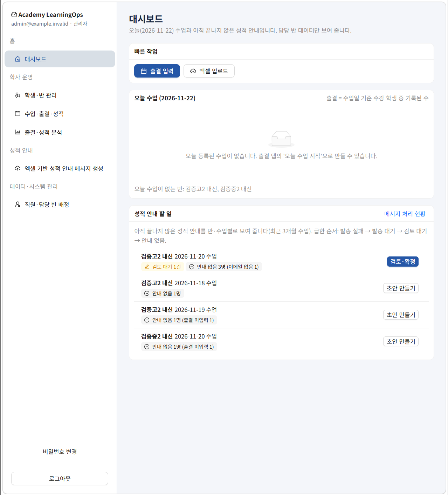
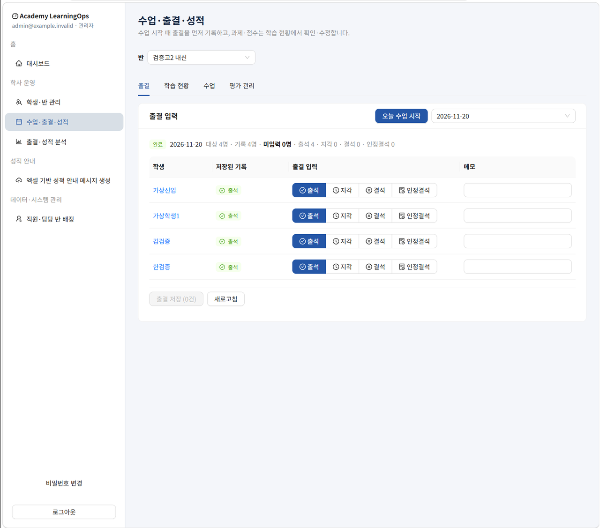
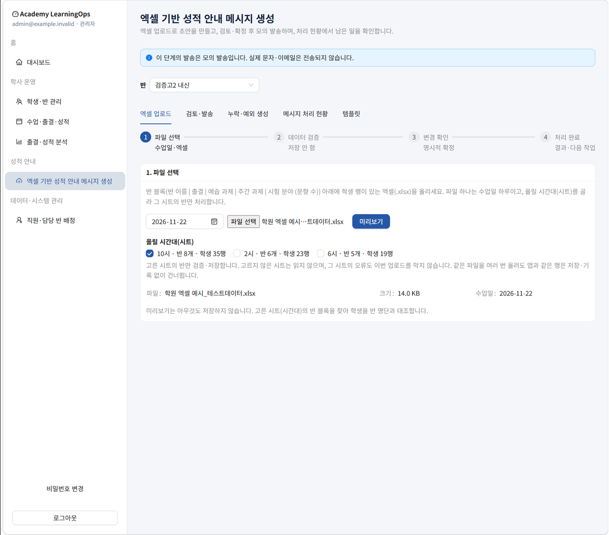
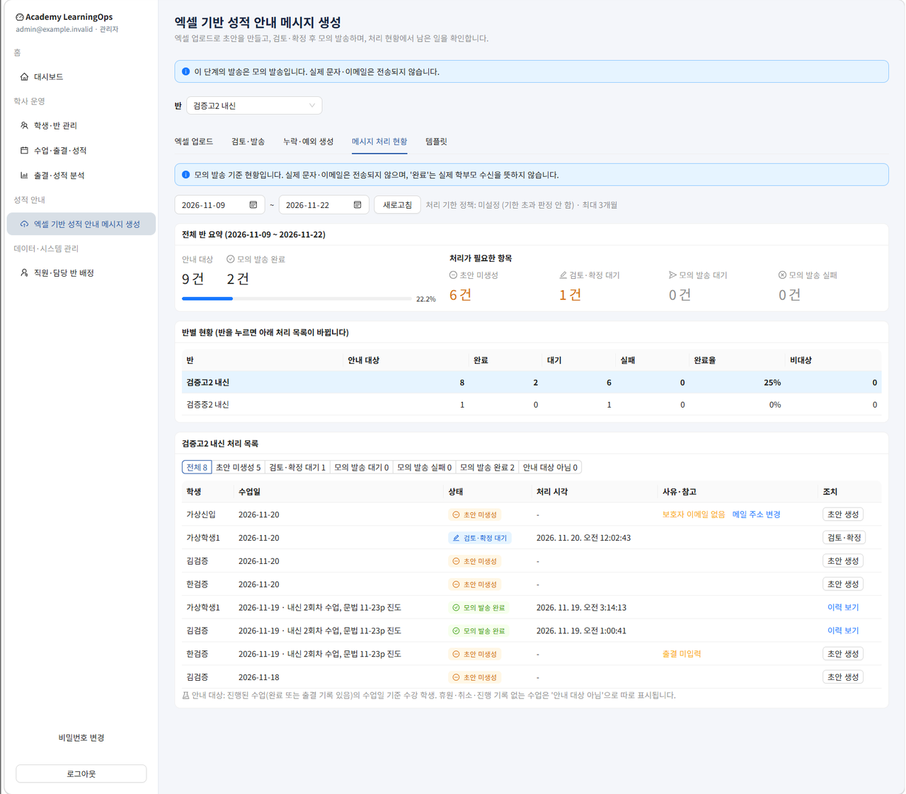
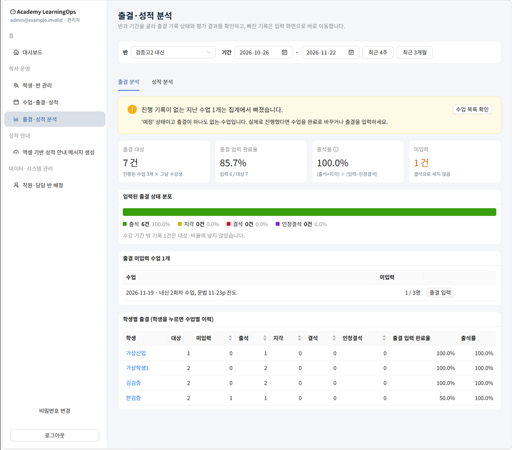
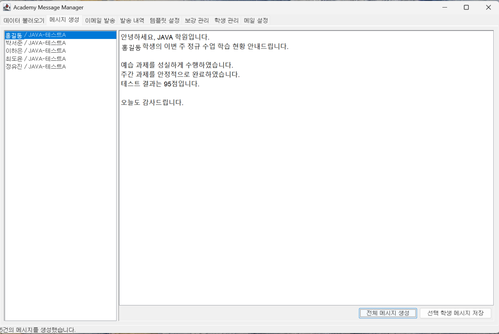
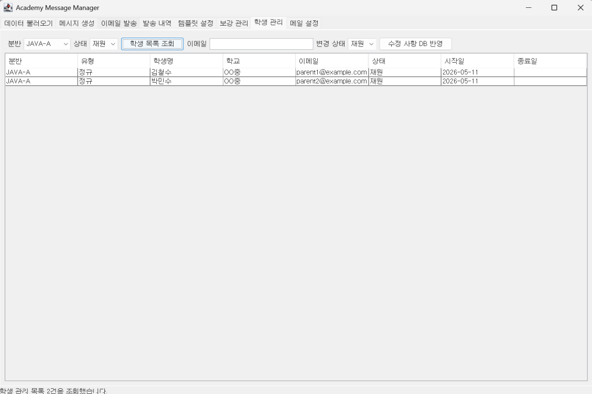
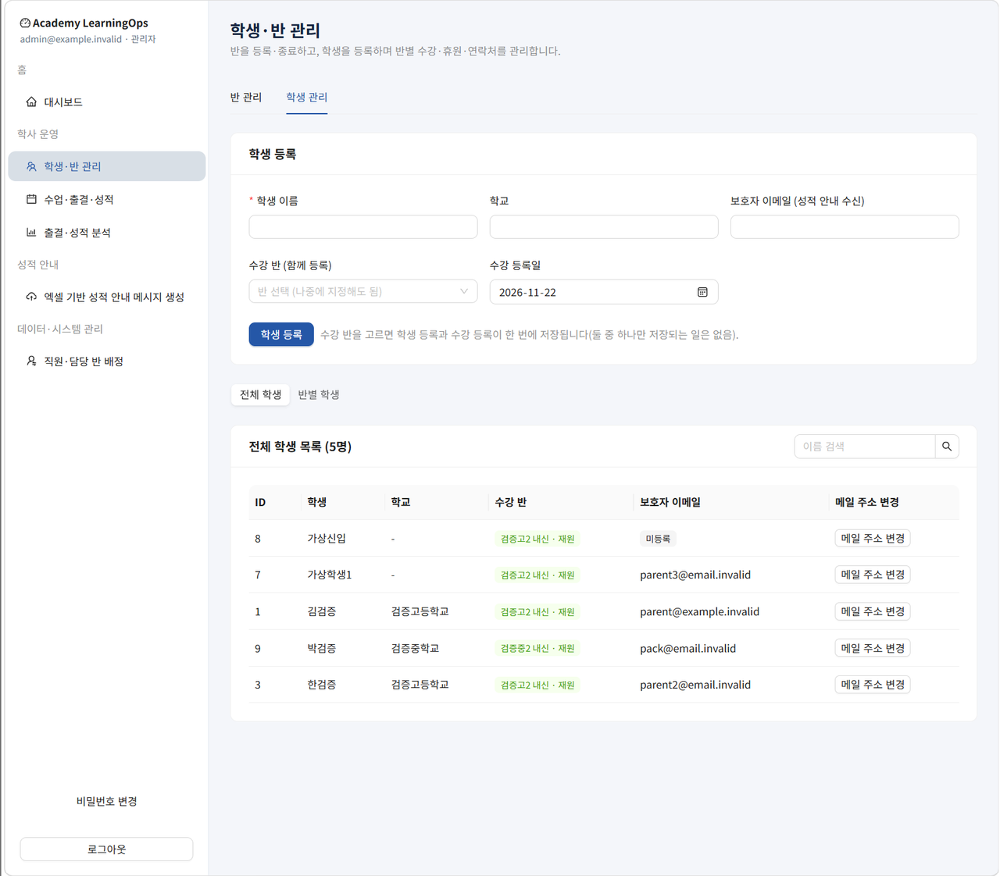

# Academy LearningOps

학원 직원(관리자·선생님·조교)을 위한 **수업·출결·성적 관리와 학부모 성적 안내 메시지** 웹서비스입니다.
Java Swing 데스크톱 프로그램(v1.x)을 **FastAPI + React + PostgreSQL** 웹서비스(v2.0.0)로 전환했습니다.

> 학부모 메시지 발송은 **모의 발송(Mock)** 입니다. 실제 문자·이메일은 보내지 않습니다.

저장소 이름 AcademyMessageManager는 v1.x(Java) 시절 이름이며, v2.0.0부터 Academy LearningOps로 바뀌었습니다.

## 배경

학원은 수업마다 출결·과제·시험 결과를 정리해 학부모에게 학습 현황을 안내해야 합니다.
처음에는 이 일을 Java Swing 데스크톱 프로그램(v1.0~v1.2)으로 자동화했습니다. 엑셀·CSV를 불러와 메시지를 만들고 Gmail SMTP로 발송하는 방식이었습니다.
하지만 한 PC에서 한 사람만 쓰는 구조였고, 화면 클래스 하나가 업무 절차까지 맡고 있었으며, 직원별 권한 구분도 없었습니다.

v2.0.0은 같은 업무를 여러 직원이 역할에 맞게 나눠 쓰는 웹서비스로 옮겼습니다.
- 서버가 인증·권한·데이터 정합성을 책임지도록 다시 설계했다.
- 실제 학원 업무 흐름을 기준으로 화면을 구성했다: 출결 입력 → 주간 엑셀 업로드 → 메시지 검토·확정 → 발송.

자세한 과정은 [Development History](docs/DEVELOPMENT_HISTORY.md)에 있습니다.

## 주요 기능

| 영역 | 기능 |
|---|---|
| 대시보드 | 반·수업별로 남은 성적 안내 할 일(발송 실패 → 발송 대기 → 검토 대기 → 안내 없음 순) |
| 학생·반 관리 | 반 등록·종료, 학생 등록과 수강 등록, 반별 학생, 휴원·복귀, 보호자 메일 주소 변경(관리자) |
| 수업·출결·성적 | 수업 회차, 출결(출석·지각·결석·인정결석), 과제 등급, 평가·점수, 진도표. 동시 수정 충돌 감지 |
| 주간 엑셀 업로드 | 시간대(시트) 선택 → 미리보기(저장 안 함) → 확정. 앱과 같은 행은 건너뛰고, 신규·복귀 학생을 판단 |
| 성적 안내 메시지 | 템플릿 → 초안 생성 → 검토 → 확정 → **모의 발송** → 실패 재시도. 반 단위 일괄 처리, 누락·예외 생성, 처리 현황 |
| 출결·성적 분석 | 출결 입력 완료율·출석률, 성적 분석, 관심 필요 학생, 학생 학습 리포트 |
| 직원·담당 반 | 직원 계정(관리자·선생님·조교), 담당 반 배정, 비활성화·삭제, 비밀번호 재설정 코드 발급(관리자) |
| 계정 보안 | 서버 세션·CSRF, 로그인 시도 제한, 60분 유휴 시 자동 로그아웃, 비밀번호 변경 |

권한은 서버가 판정합니다. 선생님·조교는 배정된 반의 데이터만 볼 수 있습니다.

## 화면

> 모든 화면은 가상 데이터로 촬영했습니다.

**대시보드**: 오늘 수업과 남은 성적 안내 할 일



| 출결 입력 | 주간 엑셀 업로드 |
|---|---|
|  |  |
| **메시지 처리 현황**(검토·확정·모의 발송) | **출결 분석** |
|  |  |

## 아키텍처

```text
React (Vite, Ant Design)
  │  /api  (세션 쿠키 + X-CSRF-Token)
  ▼
FastAPI ── 미들웨어: Origin 허용 목록, 본문 크기 제한, 보안 헤더, 개인정보 없는 오류 로그
  │  Router → Service(업무 규칙·트랜잭션·권한·감사) → Repository(SQLAlchemy)
  ▼
PostgreSQL 17 (FK·CHECK·UNIQUE·EXCLUDE 제약, Alembic Migration 001~011)
```

- 백엔드 모듈: `auth`, `learningops`, `academics`, `lesson_upload`, `notifications`, `message_operations`, `analytics`
- 동시성: 행 잠금과 버전 검사, 멱등 키, 메시지당 발송 성공 1회 제약, 엑셀 확정의 반별 잠금
- 데이터베이스 구조: [ERD](docs/database/ERD.md)(테이블 20개, 코드에서 자동 생성)

## 기술 스택

| 구분 | 사용 기술 |
|---|---|
| Backend | Python 3.12, FastAPI, Pydantic, SQLAlchemy 2.1, Alembic, Psycopg 3, Uvicorn, Argon2, openpyxl + defusedxml |
| Frontend | React 19, TypeScript, Vite, Ant Design, TanStack Query, Axios, React Router |
| Database | PostgreSQL 17 |
| Test·Quality | pytest, Vitest, Testing Library, Ruff, oxlint |
| Infra | Docker Compose(로컬 DB), 배포 예정: Neon · Render · Vercel |

## 버전 이력

| 버전 | 날짜 | 내용 |
|---|---|---|
| `v1.0-legacy` | 2026-08-21 | Java Swing + Oracle 데스크톱 프로그램 |
| `v1.1.0` | 2026-09-01 | 도메인·포트 계층 분리, 단위 테스트 도입(Refactoring 1) |
| `v1.2.0` | 2026-09-03 | PostgreSQL 재설계 |
| `v2.0.0` | 2026-11-21 | FastAPI + React 웹서비스로 전환 |

**Java v1.x → 웹 v2.0.0 비교**

| 업무 | Java 데스크톱(v1.x) | 웹(v2.0.0) |
|---|---|---|
| 성적 안내 메시지 | 전체 생성 → 학생별 수정 → 발송 대상 선택·확인 → Gmail로 실제 발송. 발송 로그·실패 재시도 | 초안 → 검토 → **확정(승인 기록)** → 모의 발송. 원본이 바뀌면 발송 차단, 중복 발송 방지, 반 단위 일괄 처리 |
| |  |  |
| 학생 관리 | 한 PC에서 분반별 학생 조회·수정 | 관리자가 학생·수강을 등록하고, 선생님·조교는 담당 반만 조회 |
| |  |  |

v1.x의 Java 코드는 이 브랜치에 포함하지 않고, 각 태그에 남아 있습니다. 버전별 비교와 개선 근거는 [Development History 2·9절](docs/DEVELOPMENT_HISTORY.md#9-legacy--web-비교-개선-항목별-근거)에 있습니다.

## 프로젝트 구조

```text
backend/            FastAPI 앱(app/), Alembic Migration(alembic/), 테스트(tests/), 운영 스크립트(scripts/)
frontend/           React 앱(src/)
sql/                기준 스키마(schema_postgresql.sql, Migration 001이 읽음), 시드·검증 SQL
tests/fixtures/     메시지 미리보기 계약 fixture(Python 테스트가 사용)
docs/               개발 이력·가이드·ERD·리뷰·배포 문서
scripts/            로컬 실행·검증 PowerShell 스크립트
data/               가상 샘플 데이터
```

## 시작하기

준비물: Python 3.12+, Node.js 24.x, Docker Desktop

```powershell
.\scripts\migrate-dev-db.ps1    # 개발 DB에 Migration 적용
.\scripts\bootstrap-admin.ps1   # 최초 관리자 생성
.\scripts\start-fastapi.ps1     # API  http://127.0.0.1:8000
.\scripts\start-frontend.ps1    # 화면 http://127.0.0.1:5173
```

DB 컨테이너 준비, 환경변수, 데이터 위치 정책 등 자세한 절차는 [개발 가이드](docs/DEVELOPMENT_GUIDE.md)에 있습니다.

## 테스트

```powershell
.\scripts\verify-all.ps1        # Ruff → pytest → lint → Vitest → build (DB 불필요)
```

| 범위 | 결과 | 실행일 |
|---|---|---|
| 백엔드 DB 없는 테스트 | 166개 실행 · 통과 | 2026-11-25 |
| PostgreSQL 통합 테스트(격리 테스트 DB) | 141개 실행 · 통과 | 2026-11-21 |
| 프론트엔드 Vitest | 114개 실행 · 통과 | 2026-11-25 |

- 수치는 **실행해서 통과한 테스트 수**이며, 커버리지는 측정하지 않았습니다.
- 통합 테스트는 격리된 테스트 DB에서만 실행됩니다([개발 가이드 4절](docs/DEVELOPMENT_GUIDE.md#4-테스트)).

## 배포

2026-11-24에 배포를 완료했습니다: **https://academy-message-manager.vercel.app**
- 구성: Vercel(React) · Render(FastAPI) · Neon(PostgreSQL). Vercel이 `/api` 요청을 Render로 전달합니다(`frontend/vercel.json`).
- 직원 계정으로 로그인해야 쓸 수 있습니다.
- 운영 DB에는 시연용 가상 데이터만 있습니다.
- 배포 후 점검: Render 기동·환경변수, Neon 연결, 워커·인스턴스 1개, 세션 쿠키 속성, API 문서 비공개를 확인했습니다.
  로그인 시도 제한은 구성 A′(Vercel 송신 주소 단위)로 운영합니다. 무료 플랜 유휴 정지는 아직 측정하지 않았습니다. 자세한 결과는 [Development History 3절 Phase 11](docs/DEVELOPMENT_HISTORY.md)에 있습니다.
- 배포 실행 모드(`ACADEMY_DB_MODE=production`)는 시작할 때 설정을 검증하고, 안전하지 않으면 시작을 거부합니다.
- 절차: [보안 배포 설정 가이드](docs/deployment/phase11_5_security_deployment_guide.md), [릴리스 준비도·배포 인계](docs/reviews/phase11_4_release_readiness.md)

## 문서

| 문서 | 내용 |
|---|---|
| [Development History](docs/DEVELOPMENT_HISTORY.md) | Java v1.0 → 웹 v2.0.0 개발 이력, 개선 항목별 근거, 현재 상태·로드맵 |
| [Engineering Retrospective](docs/ENGINEERING_RETROSPECTIVE.md) | 기술 결정과 회고(FastAPI 선택 이유, 기능 이식 누락 등) |
| [개발 가이드](docs/DEVELOPMENT_GUIDE.md) | 로컬 환경·테스트·스키마 변경·개발 정책 |
| [ERD](docs/database/ERD.md) | 현재 데이터베이스 구조 |
| [backend/README](backend/README.md) · [frontend/README](frontend/README.md) | 백엔드·프론트엔드 세부 안내 |
| [docs/reviews/](docs/reviews/) | 보안·정합성·성능·릴리스 점검 결과 |

## 향후 계획

- 클라우드 배포(Neon · Render · Vercel)와 배포 후 점검
- 보호자 휴대전화 기반 SMS/LMS 발송 검토. 그 전에 외부 발송과 DB 트랜잭션 분리(INT-I1)가 필요함
- Java 버전에 있던 보강 신청 관리의 웹 이식 검토
- AI 기능 추가 검토(범위 미정)
- CI(자동 테스트·의존성 검사) 구성

## 알려진 제한

- 학부모 메시지는 모의 발송만 합니다. Java 버전의 실제 Gmail SMTP 발송은 옮기지 않았습니다.
- Java 버전의 보강 신청 관리 기능은 아직 웹에 없습니다.
- 로그인 시도 제한과 비밀번호 재설정 코드가 서버 메모리에 있어서, 워커 1개로 운영해야 하고 재시작하면 초기화됩니다.
- 브라우저 E2E 자동화 테스트와 커버리지 측정은 아직 없습니다.

## 라이선스

라이선스는 아직 지정하지 않았습니다.
