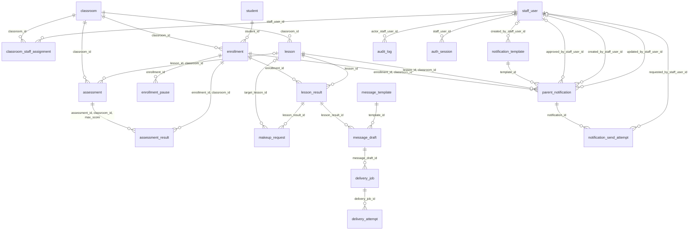
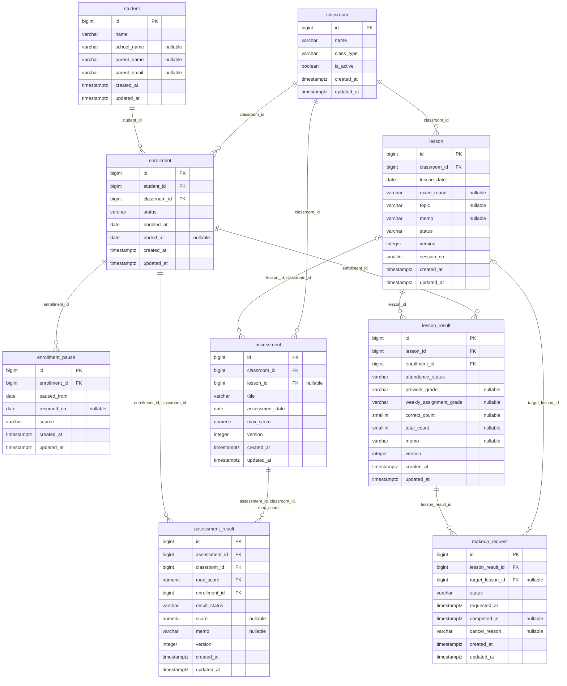
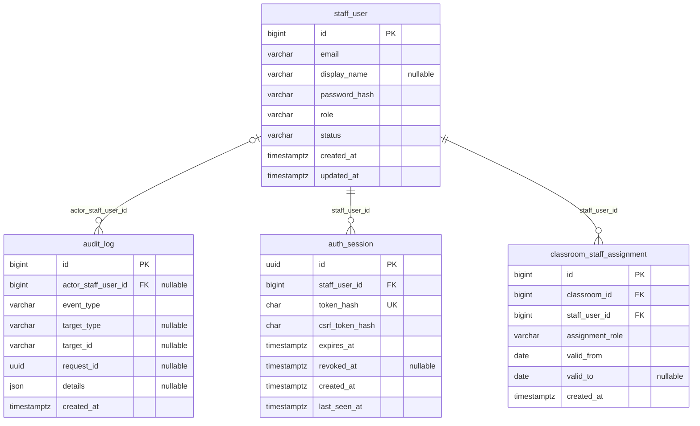
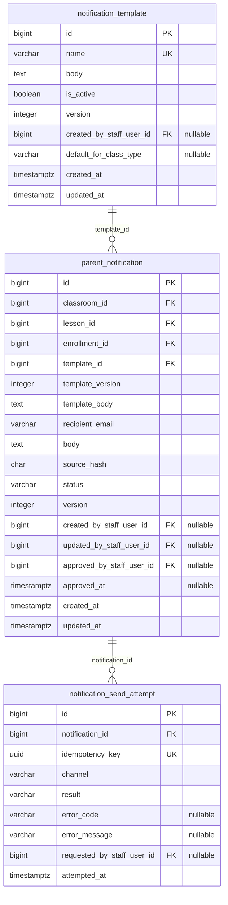
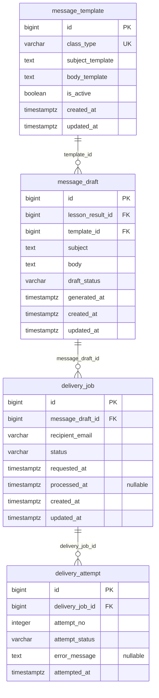

# Database ERD (현재 스키마)

> **자동 생성 문서**: `backend/scripts/generate_erd.py`가 SQLAlchemy 모델(`backend/app/db/models/tables.py`)에서 만든다. 직접 고치지 말고, Migration 뒤에 스크립트를 다시 실행한다.
> 기준: 테이블 20개, Alembic head와 일치하는 모델(`alembic check` 차이 없음 확인 대상).

- 표기: `PK` 기본키, `FK` 외래키, `UK` 단일 열 UNIQUE, `"nullable"` NULL 허용 열.
- 관계선: `||` 반드시 1, `o|` 0 또는 1(외래키 NULL 허용), `}o` 0개 이상.
- 여러 열 UNIQUE, 부분 UNIQUE, CHECK, EXCLUDE, 트리거는 그림에 나오지 않는다. 정의는 `tables.py`와 `backend/alembic/versions/`에 있다.
- 이전 ERD(`AMM_PostgreSQL_ERD_v1.3.*`, `PostgreSQL ERD v1.2.drawio`, `import-audit-erd.md`)는 Java v1.2 시절 스키마 기록이다.

## 전체 관계 개요

## 학사: 학생·반·수강·수업·출결·성적

학원 운영의 기본 데이터. 출결은 `lesson_result`, 평가 점수는 `assessment_result`에 저장한다. `makeup_request`는 Java 버전의 보강 관리용 테이블로, 웹 버전에는 화면·API가 없다.

## 직원·인증·감사

직원 계정(역할 ADMIN/TEACHER/ASSISTANT, 상태 ACTIVE/INACTIVE/DELETED), 서버 세션, 담당 반 배정, 변경 감사 기록.

## 학부모 안내 메시지(웹 버전)

템플릿 → 메시지(초안·검토·확정·모의 발송) → 발송 시도 원장. 발송 채널은 CHECK로 `MOCK`만 허용하며, `Idempotency-Key` UNIQUE와 메시지당 성공 1회 부분 UNIQUE로 중복 발송을 막는다.

## Java 레거시 메시지(웹 버전 미사용)

Java v1.2의 실제 발송 기록용 테이블. 기준선 Migration 001에서 넘어왔고 웹 서비스는 읽거나 쓰지 않는다.

