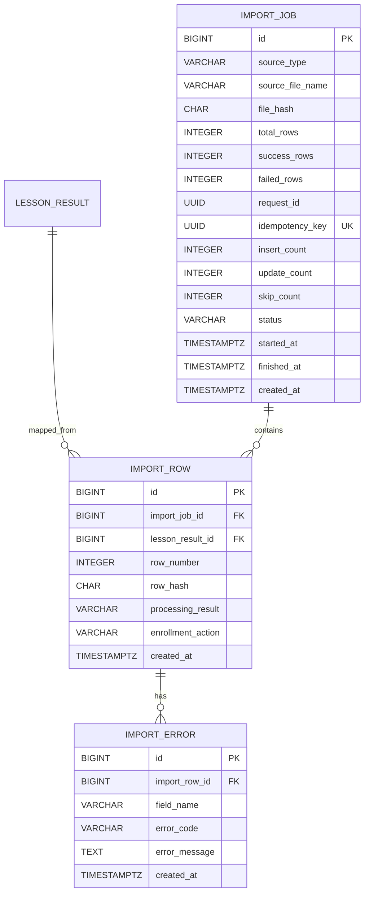

# Import Audit ERD source

> **(2026-11-22) 이전 기록**: 이 문서가 설명하는 `import_job`·`import_row`·`import_error`는 Alembic `010_drop_legacy_import_tables`로 삭제되었다(구 CSV/XLSX 가져오기 제거, Phase 9.6).
> 현재 스키마는 [`ERD.md`](ERD.md)를 본다. 아래 내용은 Java v1.2 시절의 기록으로 남겨 둔다.

이 문서는 `sql/schema_postgresql.sql`의 Import Audit 영역을 표현합니다. 공개 API는 건수·상태·시각만 반환하며 파일명, 해시, 요청 키와 행 데이터는 반환하지 않습니다.

